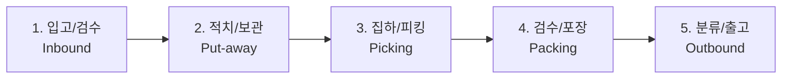

# [3장] 현장 주요 프로세스 및 직무 소개
* **작성일자**: 2026-10-28

---

## 1. 입고 (Inbound / Receiving)
* **주요 업무**: 납품 협력사 화물차량 하차, 인수 수량 확인, 송품장 대조.
* **외관 검수**: 파손, 오염, 유통기한(소비기한) 기준 충족 여부 확인.
* **바코드 등록**: 미등록 바코드 라벨 발행 및 시스템 등록.

---

## 2. 적치 및 보관 (Put-away / Stowing)
* **주요 업무**: 입고 검수가 완료된 상품을 지정된 랙(선반) 및 로케이션으로 이동.
* **매핑(Mapping)**: PDA로 선반 바코드를 먼저 찍고 상품 바코드를 스캔하여 재고 위치 확정.
* **보관 원칙**: 무거운 제품은 하단 선반, 회전율이 높은 인기 품목은 작업자 눈높이 구역(Golden Zone) 배치.

---

## 3. 집하 및 피킹 (Picking)
* **주요 업무**: 고객 주문에 따라 해당 로케이션으로 이동하여 상품을 선별 집하.
* **피킹 방식**:
  * **오더 피킹(Order Picking)**: 주문 건별로 개별 피킹.
  * **토탈/배치 피킹(Batch Picking)**: 여러 주문 건을 한 번에 모아서 피킹 후 포장 단계에서 분배.
* **주의 사항**: 외관상 유사 상품(용량, 색상 차이 등) 오피킹 주의.

---

## 4. 검수 및 포장 (Packing)
* **주요 업무**: 피킹된 상품의 바코드를 재스캔하여 오출고 방지, 박스 포장 및 운송장 부착.
* **포장 기준**:
  * 파손 위험 제품은 완충재(에어캡) 규정 매뉴얼에 따라 감싸기.
  * 액체류는 누수 방지 비닐 밀봉 후 적합한 규격의 박스 사용.
  * 운송장은 바코드가 접히거나 훼손되지 않도록 박스 상단 평평한 곳에 부착.

---

## 5. 분류 및 출고 (Outbound / Shipping)
* **주요 업무**: 권역별/택배사별(CJ, 한진, 롯데 등) 소팅 및 파레트 적재.
* **파레타이징 & 래핑**: 화물이 배송 중 붕괴되지 않도록 스트레치 필름으로 견고히 래핑.
* **상차**: 차량 도착 시 도크 레벨러를 연결하고 적재 규정에 맞춰 상차 완료.
